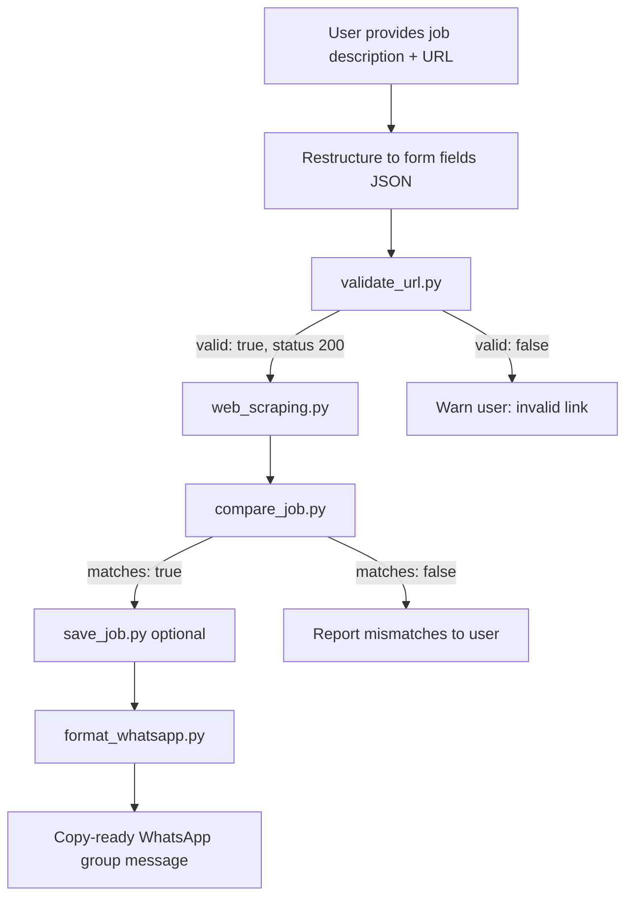

# Job Alert Validation Workflow



## Script order

1. `validate_job.py` — optional single command for steps 2–5 below
2. `validate_url.py` — always run first when a URL is present
3. `web_scraping.py` — only after validation succeeds
4. `compare_job.py` — compare restructured user JSON with scraped JSON
5. `save_job.py` — after a successful comparison, store JSON under `job_postings/`
6. `format_whatsapp.py` — print a copy-ready WhatsApp group message (does not send)
7. `list_jobs.py` / `housekeep_jobs.py` — index and maintain the local `job_postings/` library

## Example commands

```bash
pip install -r requirements.txt
pip install -r requirements-dev.txt
pytest

python scripts/validate_job.py tests/fixtures/jobs/user_job.json --scraped-json tests/fixtures/jobs/scraped_job.json --pretty --whatsapp --save

python scripts/validate_url.py "https://example.com/jobs/123" --pretty
python scripts/web_scraping.py "https://example.com/jobs/123" --pretty > scraped_job.json
python scripts/compare_job.py tests/fixtures/jobs/user_job.json tests/fixtures/jobs/scraped_job.json --pretty
python scripts/format_whatsapp.py tests/fixtures/jobs/user_job.json
python scripts/match_resume.py resume.pdf --pretty
```

Validated job JSON files are written locally to `job_postings/` for resume matching. They are gitignored and must not be committed. Canonical field list: [schemas/job_schema.json](../schemas/job_schema.json).

URL probing uses [url_hosts.json](url_hosts.json) for short links (e.g. TCS `on.tcs.com`), event pages (e.g. Hack2Skill), and discouraged hosts (LinkedIn). Extend that file when a new apply-link domain needs GET-first or extra warnings.
