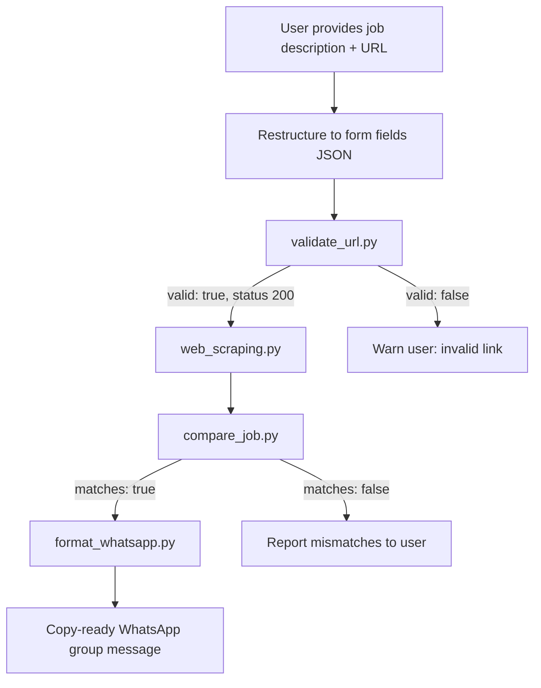

# Job Alert Validation Workflow



## Script order

1. `validate_url.py` — always run first when a URL is present
2. `web_scraping.py` — only after validation succeeds
3. `compare_job.py` — compare restructured user JSON with scraped JSON
4. `format_whatsapp.py` — print a copy-ready WhatsApp group message (does not send)

## Example commands

```bash
pip install -r requirements.txt

python scripts/validate_url.py "https://example.com/jobs/123" --pretty
python scripts/web_scraping.py "https://example.com/jobs/123" --pretty > scraped_job.json
python scripts/compare_job.py user_job.json scraped_job.json --pretty
python scripts/format_whatsapp.py user_job.json
python scripts/match_resume.py resume.pdf --pretty
```

Validated job JSON files live in `job_postings/`. Resume matching reads that folder.
